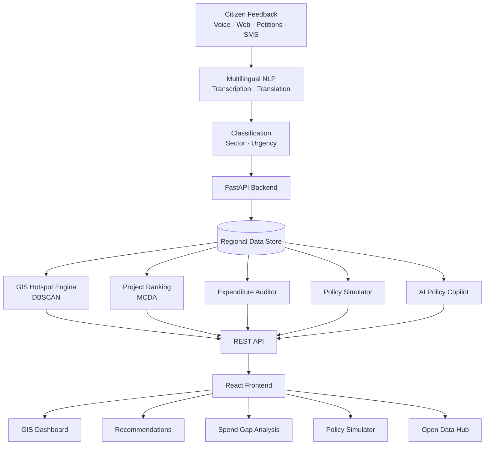

# CivicPulse — AI-Powered Citizen Infrastructure Intelligence

<p align="center">
  <strong>Turning citizen voices into data-informed infrastructure decisions.</strong>
  <br />
  A multilingual, geospatial AI platform for citizen feedback, public investment prioritization, and policy decision support.
</p>

<p align="center">
  <a href="https://digitalpublicgoods.net/">
    
  </a>
  
  
  
  
  
</p>

<p align="center">
  
  
  
</p>

---

## Table of Contents

- [Overview](#overview)
- [Problem Statement](#problem-statement)
- [Key Features](#key-features)
- [System Architecture](#system-architecture)
- [Technology Stack](#technology-stack)
- [Project Structure](#project-structure)
- [Getting Started](#getting-started)
- [API Documentation](#api-documentation)
- [Deployment](#deployment)
- [Supported Regions and Languages](#supported-regions-and-languages)
- [Privacy and Security](#privacy-and-security)
- [Testing](#testing)
- [Future Scope](#future-scope)
- [Contributing](#contributing)
- [License](#license)
- [Author](#author)

---

## Overview

**CivicPulse** is a multilingual AI-powered citizen infrastructure intelligence platform designed to connect grassroots public concerns with infrastructure planning and capital investment decisions.

Governments and public institutions receive citizen complaints through many different channels. However, these reports are often fragmented, difficult to analyze across languages, and disconnected from the processes used to prioritize public spending.

CivicPulse brings these workflows into a unified platform combining citizen feedback processing, geospatial analysis, infrastructure project ranking, expenditure-gap analysis, policy simulation, and AI-assisted reporting.

The project is designed around Digital Public Good principles, open data interoperability, and transparent decision support.

### Primary Objectives

- Make citizen feedback more accessible across language barriers.
- Identify geographic concentrations of infrastructure problems.
- Prioritize projects using configurable, explainable criteria.
- Highlight potential gaps between public needs and planned investment.
- Support evidence-informed infrastructure and policy planning.
- Provide machine-readable data for interoperability with external tools.

## Problem Statement

### 1. Misaligned Public Spending

Infrastructure investment may not reflect the geographic distribution or urgency of citizen needs.

### 2. Unidentified Infrastructure Deficits

Authorities need better ways to identify locations experiencing problems with roads, water, healthcare, energy, education, and other essential services.

### 3. Linguistic Barriers

Citizens who communicate in regional languages may encounter difficulties when reporting problems through systems designed primarily for a single language.

### 4. Fragmented Public Feedback

Voice reports, petitions, web forms, and other submissions can be difficult to consolidate into a consistent analytical dataset.

### 5. Limited Decision Transparency

Infrastructure prioritization requires transparent criteria that account for demand, deficits, vulnerability, feasibility, and expected social impact.

CivicPulse aims to address these challenges through a unified citizen-feedback and infrastructure decision-support workflow.

---

## Key Features

### 1. Multilingual Citizen Feedback

- Voice-based grievance submission and speech-to-text processing.
- Web-based complaint forms.
- Language identification and translation workflows.
- Infrastructure-sector classification.
- Urgency and severity scoring.
- Community petitions and upvoting.
- Messaging-channel and SMS integration simulations.

### 2. Geospatial Intelligence

- Interactive GIS visualization using Leaflet.
- Geographic clustering of citizen complaints using DBSCAN.
- Demand-hotspot identification.
- Infrastructure-deficit and vulnerability overlays.
- District-level demographic drilldowns.
- GeoJSON-compatible geographic data.

### 3. Infrastructure Project Prioritization

CivicPulse uses Multi-Criteria Decision Analysis (MCDA) to rank candidate projects using configurable weights.

The conceptual scoring model is:

\[
S = w_1D + w_2I + w_3V + w_4F
\]

Where:

- \(S\): Project priority score.
- \(D\): Citizen demand.
- \(I\): Infrastructure deficit.
- \(V\): Population vulnerability.
- \(F\): Project feasibility.
- \(w_1, w_2, w_3, w_4\): Configurable criterion weights.

The platform is designed to display ranked recommendations, estimated beneficiaries, indicative costs, implementation timelines, and relevant Sustainable Development Goal alignments.

These scores support decision-making and do not replace engineering assessments or formal public procurement procedures.

### 4. Public Expenditure Misalignment Auditor

- Compares infrastructure needs with planned capital allocations.
- Identifies high-demand areas that may be inadequately funded.
- Highlights potential spending mismatches.
- Supports analysis of lower-priority versus high-need projects.
- Generates recommendations for further review by planning and finance teams.

### 5. Policy Simulation

- Interactive budget allocation across seven infrastructure sectors.
- Configurable vulnerability equity multiplier.
- Scenario-based comparison of investment choices.
- Indicative deficit-reduction and citizen-satisfaction metrics.
- Illustrative SDG progress and economic multiplier estimates.

Simulation outputs depend on the assumptions and datasets provided. They should not be interpreted as guaranteed economic forecasts.

### 6. AI Policy Copilot

- Drafts policy briefs and executive summaries.
- Assists with procurement tender specifications.
- Generates structured citizen-status notifications.
- Organizes findings into decision-support documents.
- Connects recommendations to underlying data where supported by the implementation.

AI-generated documents require human review before official use.

### 7. Open Data Hub

- CSV data exports.
- GeoJSON exports for geographic applications.
- JSON-LD data representations.
- REST API interoperability.
- OpenAPI documentation.
- Swagger UI and ReDoc support.

The goal is to make CivicPulse data easier to inspect, exchange, and reuse across compatible tools.

---

## System Architecture

The following Mermaid diagram describes the high-level flow from citizen feedback to analytical insights and frontend dashboards.



### Architecture Layers

| Layer | Responsibility |
|---|---|
| Citizen input | Collects citizen reports, petitions, and voice submissions |
| NLP processing | Processes language, transcribes audio, and classifies complaints |
| API backend | Validates requests and coordinates application services |
| Data layer | Supplies regional, demographic, complaint, and investment data |
| Analytics | Performs hotspot detection, project ranking, and expenditure analysis |
| Policy intelligence | Supports scenario analysis and AI-assisted document drafting |
| Frontend | Presents maps, recommendations, reports, and interactive tools |
| Interoperability | Exposes APIs and supported machine-readable data exports |

The diagram represents the intended logical architecture. Actual integrations and production capabilities depend on the implemented services and configuration.

---

## Technology Stack

| Technology | Purpose |
|---|---|
| React 19 | Frontend application |
| JavaScript | Frontend logic |
| Vite | Frontend development and build tooling |
| Python | Backend and analytics logic |
| FastAPI | REST API framework |
| Pydantic | Request and data validation |
| Leaflet | Interactive mapping |
| DBSCAN | Geographic density clustering |
| MCDA | Multi-criteria project prioritization |
| GeoJSON | Geographic data representation |
| CSV | Tabular data exchange |
| JSON-LD | Structured linked data |
| OpenAPI | API specification |
| Swagger UI / ReDoc | Interactive API documentation |
| Pytest | Backend testing |
| Cloudflare Workers | Frontend asset deployment, when configured |

---

## Project Structure

```text
CivicPulse/
├── backend/
│   ├── app/
│   │   ├── api/
│   │   │   └── endpoints.py
│   │   ├── models/
│   │   │   └── schemas.py
│   │   ├── services/
│   │   │   ├── multilingual_nlp.py
│   │   │   ├── voice_processor.py
│   │   │   ├── data_store.py
│   │   │   ├── hotspot_engine.py
│   │   │   ├── recommendation_engine.py
│   │   │   ├── misalignment_engine.py
│   │   │   ├── policy_simulator.py
│   │   │   └── ai_copilot.py
│   │   └── main.py
│   ├── tests/
│   │   └── test_api.py
│   └── requirements.txt
│
├── frontend/
│   ├── src/
│   │   ├── components/
│   │   │   ├── Navbar.jsx
│   │   │   ├── GISMap.jsx
│   │   │   ├── CitizenPortal.jsx
│   │   │   ├── RecommendationView.jsx
│   │   │   ├── MisalignmentView.jsx
│   │   │   ├── PolicySimulator.jsx
│   │   │   ├── AICopilotModal.jsx
│   │   │   └── DPGHub.jsx
│   │   ├── services/
│   │   │   └── api.js
│   │   ├── App.jsx
│   │   └── index.css
│   ├── index.html
│   ├── package.json
│   └── package-lock.json
│
├── README.md
├── SECURITY.md
├── LICENSE
├── NOTICE
├── COPYRIGHT
├── .nvmrc
├── package.json
└── wrangler.jsonc
```

*This tree reflects the documented architecture. Keep it synchronized with the files actually present in the repository.*

---

## Getting Started

### Prerequisites

Install:

- Python 3.10 or later.
- Node.js 18 or later.
- npm 9 or later.
- Git.

Verify the installations:

```bash
python --version
node --version
npm --version
git --version
```

### Option 1: Run the Full Application

From the repository root:

```bash
npm install
npm run dev
```

The root development script is intended to start both the FastAPI backend and React frontend.

Expected local addresses:

| Service | URL |
|---|---|
| Frontend | http://localhost:5173 |
| Backend API | http://localhost:8000 |
| Swagger UI | http://localhost:8000/docs |
| ReDoc | http://localhost:8000/redoc |

### Option 2: Run the Backend Separately

From the repository root:

```bash
cd backend
python -m pip install -r requirements.txt
python -m uvicorn app.main:app --port 8000 --reload
```

The backend should be available at:

`http://localhost:8000`

API documentation:

`http://localhost:8000/docs`

### Run the Frontend

Open a second terminal:

```bash
cd frontend
npm install
npm run dev
```

Open:

`http://localhost:5173`

If the frontend and backend run on different hosts, configure the API base URL and CORS settings appropriately.

---

## API Documentation

FastAPI provides interactive documentation when the backend is running.

| Documentation | Endpoint |
|---|---|
| Swagger UI | `/docs` |
| ReDoc | `/redoc` |
| OpenAPI schema | `/openapi.json` |

These endpoints describe the routes registered by the running backend.

For a deployed instance, replace `localhost:8000` with the backend's actual address.

---

## Deployment

### Frontend — Cloudflare Workers

The repository includes configuration for deploying the built frontend as static assets.

Typical build configuration:

- **Root directory:** `/`
- **Build command:** `npm run build`
- **Deploy command:** `npx wrangler deploy`

The root build installs the frontend dependencies and builds the frontend assets. The `wrangler.jsonc` configuration serves the generated frontend and supports single-page application routing.

### Backend — FastAPI

The backend must be hosted separately from the static frontend deployment.

Deployment checklist:

1. Install Python dependencies.
2. Configure production environment variables.
3. Set the allowed frontend origins.
4. Configure durable storage and production authentication.
5. Deploy the FastAPI application to a Python-compatible host.
6. Set the frontend API base URL.
7. Verify the API, CORS, authentication, and application routes.

### Environment Variables

| Variable | Purpose |
|---|---|
| `CIVICPULSE_ENV` | Backend environment |
| `CIVICPULSE_ALLOWED_ORIGINS` | Allowed frontend origins |
| `CIVICPULSE_DEMO_MODE` | Controls demonstration sign-in behavior |
| `VITE_API_BASE_URL` | Public frontend API base URL |

Example frontend configuration:

```env
VITE_API_BASE_URL=https://api.example.org/api
```

The correct URL depends on the API routes registered by the deployed backend.

**Security:** Variables beginning with `VITE_` are embedded in public frontend assets. Never place secrets or private credentials in them.

Consult `SECURITY.md` before production deployment.

---

## Supported Regions and Languages

CivicPulse documents regional baseline data for the following BRICS nations.

| Country | Example Regions | Languages |
|---|---|---|
| India | Uttar Pradesh, Maharashtra, Bihar, Rajasthan, Kerala | Hindi, Marathi, Tamil, Bengali, Telugu, English |
| Brazil | Bahia, Amazonas, São Paulo, Minas Gerais | Portuguese |
| South Africa | Eastern Cape, KwaZulu-Natal, Western Cape | isiZulu, Afrikaans, isiXhosa, English |
| China | Sichuan, Guizhou, Shandong | Mandarin Chinese |
| Russia | Novgorod Oblast, Irkutsk Oblast, Sverdlovsk | Russian |

Actual regional coverage and language-processing quality depend on the configured datasets and processing services.

---

## Privacy and Security

Citizen feedback may contain sensitive personal or location information. Deployments should incorporate appropriate safeguards.

- Validate input and restrict abusive requests.
- Apply authentication and authorization to administrative functions.
- Use HTTPS for production traffic.
- Configure CORS for trusted origins only.
- Minimize collection of personally identifiable information.
- Apply privacy-aware handling to geographic exports.
- Protect credentials through environment variables or secret-management systems.
- Establish appropriate data retention and deletion procedures.
- Use durable session and user storage in production.
- Review AI-generated recommendations before making consequential decisions.

Demonstration authentication and in-memory user/session stores are not suitable for production deployments.

---

## Testing

Run the backend test suite from the repository root:

```bash
python -m pytest backend/tests -v
```

Recommended verification areas include:

- API validation and error handling.
- Citizen grievance processing.
- Language and sector classification.
- Geographic hotspot calculations.
- MCDA ranking behavior.
- Expenditure-gap analysis.
- Policy simulation constraints.
- Data export formats.
- Production CORS and authentication.

Only report test counts and results after running the tests against the current codebase.

---

## Future Scope

Potential extensions include:

- Production messaging and SMS integrations.
- Expanded regional language and dialect support.
- Improved voice processing in noisy environments.
- Regularly updated and independently verified infrastructure datasets.
- Historical-data validation for prioritization and policy models.
- Role-based access control and audit logging.
- Stronger privacy and security evaluations.
- Integration with authorized government data systems.
- Accessibility and low-bandwidth improvements.
- Independent assessments of open-data interoperability and Digital Public Good readiness.

---

## Contributing

Contributions, bug reports, and suggestions are welcome.

1. Fork the repository.
2. Create a feature branch.
3. Implement your change.
4. Run the relevant tests.
5. Commit your changes with a descriptive message.
6. Submit a pull request describing the change.

Example:

```bash
git checkout -b feature/your-feature
git add .
git commit -m "feat: describe your change"
git push origin feature/your-feature
```

Do not commit credentials, real citizen records, or private datasets.

---

## License

Copyright © 2026 Praveen Reddy.

See the repository's `LICENSE`, `NOTICE`, and `COPYRIGHT` files for the actual licensing terms.

The project documentation references AGPL-3.0 and Apache License 2.0. Ensure the checked-in license files consistently establish the intended licensing arrangement before distributing the project.

---

## Author

**Praveen Reddy**

AI/ML Developer · Software Developer · Open-Source Builder

- GitHub: [@reddy895](https://github.com/reddy895)

---

<p align="center">
  <strong>CivicPulse</strong><br />
  Building a more transparent, inclusive, and data-informed approach to infrastructure planning.
</p>
