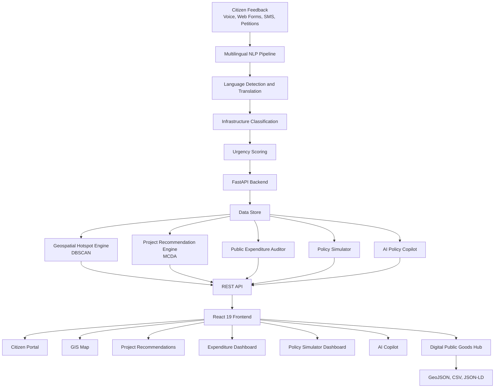

# CivicPulse 🌍

**CivicPulse** is a multilingual AI-powered Digital Public Good that connects citizen infrastructure complaints with government investment planning across BRICS nations.

## 🚀 Features

- **Multilingual AI:** Processes citizen complaints in multiple languages.
- **Voice & Text Complaints:** Supports voice submissions, web forms, and messaging-channel simulations.
- **GIS Hotspot Detection:** Identifies geographic clusters of infrastructure problems using DBSCAN.
- **AI Project Prioritization:** Ranks infrastructure projects using Multi-Criteria Decision Analysis (MCDA).
- **Expenditure Auditor:** Identifies potential gaps between public demand and infrastructure spending.
- **Policy Simulator:** Explores hypothetical infrastructure budget allocations.
- **AI Policy Copilot:** Assists with policy briefs and procurement document drafts.
- **Open Data Hub:** Supports GeoJSON, CSV, and JSON-LD exports.

## 🏗️ System Architecture



## 🛠️ Tech Stack

| Component | Technologies |
|---|---|
| Frontend | React 19, JavaScript, Vite |
| Backend | Python, FastAPI |
| Geospatial | Leaflet, DBSCAN, GeoJSON |
| Decision Intelligence | MCDA, policy simulation |
| API | REST, OpenAPI |
| Testing | Pytest |

## 📂 Project Structure

```text
CivicPulse/
├── backend/
│   ├── app/
│   │   ├── api/
│   │   ├── models/
│   │   ├── services/
│   │   └── main.py
│   ├── tests/
│   └── requirements.txt
├── frontend/
│   ├── src/
│   │   ├── components/
│   │   ├── services/
│   │   ├── App.jsx
│   │   └── index.css
│   └── package.json
├── README.md
└── SECURITY.md
```

## ⚡ Getting Started

### Prerequisites

- Python 3.10+
- Node.js 18+
- npm

### 1. Start the Backend

```bash
cd backend
python -m pip install -r requirements.txt
python -m uvicorn app.main:app --reload --port 8000
```

Backend API: `http://localhost:8000`

API documentation: `http://localhost:8000/docs`

### 2. Start the Frontend

Open another terminal:

```bash
cd frontend
npm install
npm run dev
```

Frontend: `http://localhost:5173`

### 3. Run Tests

From the project root:

```bash
python -m pytest backend/tests -v
```

## 🌐 Supported Nations

- 🇮🇳 India
- 🇧🇷 Brazil
- 🇿🇦 South Africa
- 🇨🇳 China
- 🇷🇺 Russia

Language and regional coverage depend on the datasets and processing services configured for the project.

## 🔒 Security

- Validate citizen submissions and API requests.
- Protect sensitive citizen information.
- Configure production CORS and authentication.
- Do not use demonstration authentication or in-memory sessions for production deployments.
- Review `SECURITY.md` before deployment.

## 🤝 Contributing

1. Fork the repository.
2. Create a feature branch.
3. Make your changes and run tests.
4. Submit a pull request.

## 👨‍💻 Author

**Praveen Reddy**

GitHub: [@reddy895](https://github.com/reddy895)

## 📄 License

See the repository's `LICENSE`, `NOTICE`, and `COPYRIGHT` files for the applicable licensing terms.

---

*Turning citizen voices into data-informed infrastructure decisions.*
